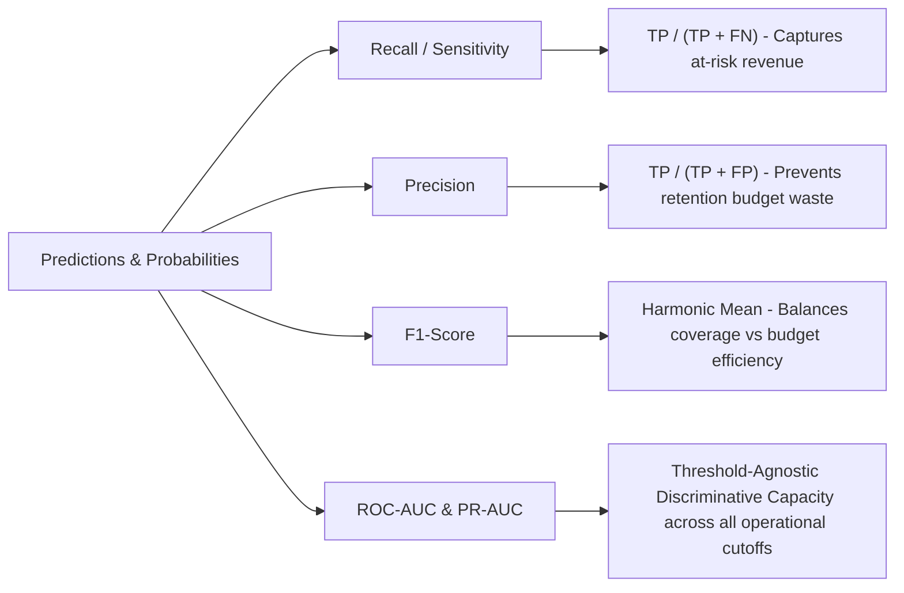
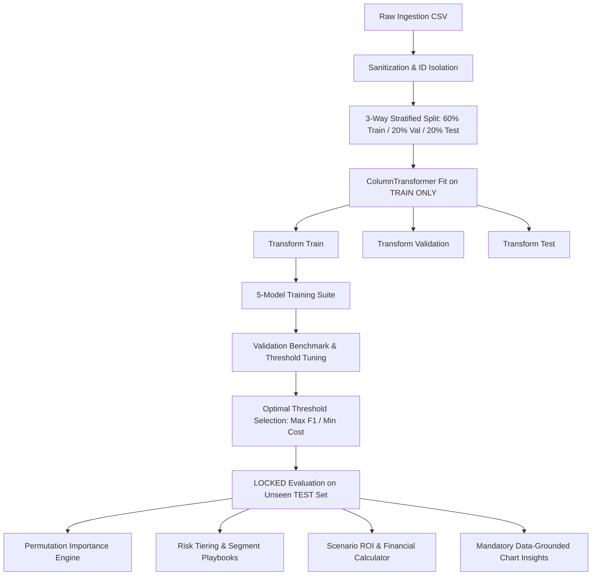
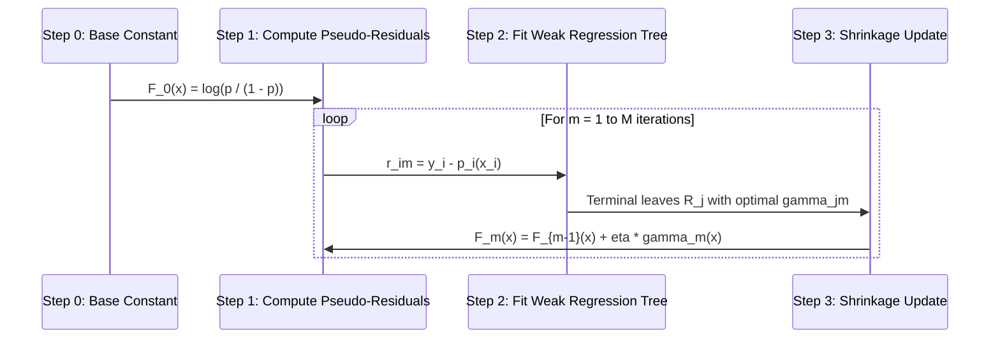

# 📘 ChurnSense: Comprehensive Technical, Mathematical & Business Architecture Report

---

## 🎯 Executive Summary

**ChurnSense** is an enterprise-grade customer churn intelligence, predictive modeling, and retention optimization platform. It bridges the gap between raw machine learning probability estimations and bottom-line corporate financial decision-making.

This report provides an in-depth breakdown structured into four foundational questions:
1. **WHY are we doing this?** — The business economics, asymmetric cost matrices, class imbalance dynamics, and the failure of naive metrics.
2. **WHAT does the model do?** — The functional role, input-to-output mappings, model taxonomy, and operational outputs.
3. **HOW is it done?** — The end-to-end data pipeline, leakage-free 3-way stratified architecture, model benchmarker, threshold explorer, and explainability modules.
4. **HOW does it do it?** — The underlying mathematical formulas, loss functions, optimization algorithms, and statistical mechanics governing every model and decision boundary.

---

## 1. WHY We Are Doing This: The Business & ML Motivation

### 1.1 The Microeconomics of Churn: CAC vs. CRC
In subscription, telecommunications, and SaaS business models, customer acquisition and retention exhibit a massive economic disparity:
- **Customer Acquisition Cost (CAC):** Acquiring a new customer involves advertising, marketing funnels, sales commissions, onboarding collateral, and initial infrastructure setup. Empirical industry benchmarks show that acquiring a new customer costs **5 to 7 times more** than retaining an existing customer.
- **Customer Retention Cost (CRC):** Retaining an existing customer at risk of churn requires targeted, high-leverage interventions: loyalty discounts, contract restructuring, priority technical support, or personalized plan upgrades. Typically, CRC is a fraction of the Customer Lifetime Value (LTV).
- **Compounding Impact of Churn:** A 5% reduction in customer churn rate can increase recurring operating profits by **25% to 95%** over multi-year horizons due to preserved cumulative recurring revenue without recurring acquisition expenditures.

---

### 1.2 The Asymmetric Loss Matrix: Why Errors Are Not Equal
Standard machine learning loss functions often treat classification errors symmetrically: a False Positive (FP) is penalized with the same weight as a False Negative (FN). In business operations, **this symmetry is fundamentally false**.

Consider the real-world operational cost matrix:

| Ground Truth \ Prediction | Predicted Negative ($\hat{y} = 0$: Stays) | Predicted Positive ($\hat{y} = 1$: Churns) |
| :--- | :--- | :--- |
| **Actual Negative ($y = 0$: Stays)** | **True Negative (TN)**<br>Cost: $\$0$<br>Outcome: Business as usual. | **False Positive (FP)**<br>Cost: $C_{\text{retention}}$ ($\approx \$15 - \$30$)<br>Outcome: Unnecessary retention incentive granted to a loyal customer. Small budget wastage. |
| **Actual Positive ($y = 1$: Churns)** | **False Negative (FN)**<br>Cost: $-LTV$ ($\approx \$600 - \$1,500+$)<br>Outcome: **Catastrophic failure.** The customer churns unnoticed. 100% of future cash flows and acquisition investment lost forever. | **True Positive (TP)**<br>Net Value: $LTV \times P_{\text{save}} - C_{\text{retention}}$<br>Outcome: High-risk customer flagged; proactive campaign saves the account with probability $P_{\text{save}}$. |

$$\text{Asymmetric Ratio: } \frac{\text{Cost}(FN)}{\text{Cost}(FP)} \approx \frac{\$800}{\$25} = 32\times$$

Because a False Negative is orders of magnitude more expensive than a False Positive, **maximizing Recall (minimizing False Negatives) is paramount**, while maintaining acceptable Precision to prevent total budget exhaustion.

---

### 1.3 The Class Imbalance Trap: Why Default Accuracy Fails
Customer churn datasets exhibit natural class imbalance. In typical telecommunications data:
- Non-Churners ($y = 0$): $\approx 73.5\%$
- Churners ($y = 1$): $\approx 26.5\%$

If an engineer trains a naive, non-informative model that blindly predicts $\hat{y} = 0$ for every single customer:
$$\text{Accuracy} = \frac{TN + TP}{Total} = \frac{0.735 \cdot N + 0}{N} = 73.5\%$$

On paper, a $73.5\%$ accuracy figure seems superficially acceptable to a non-technical manager. In reality:
$$\text{Recall} = \frac{TP}{TP + FN} = \frac{0}{0 + 0.265 \cdot N} = 0.0\%$$
Every single churner is lost. The business loses all at-risk revenue. This demonstrates why **Accuracy is an invalid metric for churn prediction**, and why evaluation must rely on Recall, Precision, F1-Score, ROC-AUC, and PR-AUC.

---

### 1.4 The Metric Evaluation Matrix



1. **Recall (Sensitivity):** $\frac{TP}{TP + FN}$. Measures the proportion of actual churners the model detects. In business terms: *What percentage of at-risk revenue did we intercept?*
2. **Precision:** $\frac{TP}{TP + FP}$. Measures how many of the flagged customers are genuine churners. In business terms: *What percentage of our intervention budget was spent on actual flight risks?*
3. **Specificity:** $\frac{TN}{TN + FP}$. Measures the proportion of loyal customers correctly left alone.
4. **F1-Score:** $\frac{2 \cdot \text{Precision} \cdot \text{Recall}}{\text{Precision} + \text{Recall}}$. The harmonic mean penalizing models that compromise one metric to inflate the other.
5. **ROC-AUC (Receiver Operating Characteristic - Area Under Curve):** Measures ranking ability across all possible thresholds by plotting True Positive Rate vs. False Positive Rate.
6. **PR-AUC (Precision-Recall Area Under Curve / Average Precision):** Crucial under class imbalance because it focuses purely on the minority positive class without being inflated by a large pool of True Negatives.

---

### 1.5 Deconstructing the Default 0.5 Threshold Fallacy
Every off-the-shelf classifier in `scikit-learn` applies an arbitrary default decision rule:
$$\hat{y} = \begin{cases} 1 & \text{if } \hat{p} \ge 0.50 \\ 0 & \text{if } \hat{p} < 0.50 \end{cases}$$

This cutoff assumes equal misclassification costs ($C_{FN} = C_{FP}$) and equal prior class probabilities ($P(y=1) = P(y=0)$). Neither assumption holds in customer churn.
- If $C_{FN} \gg C_{FP}$, the mathematically optimal threshold $\tau^*$ is significantly lower than $0.50$ (often $\tau \in [0.25, 0.38]$).
- A lower threshold intentionally converts borderline False Negatives into True Positives at the expense of a modest increase in False Positives, dramatically decreasing total enterprise loss.

---

## 2. WHAT Does the Model Do?

### 2.1 Functional Objective
The model learns a mapping from high-dimensional customer feature space $\mathcal{X} \subset \mathbb{R}^d$ to a posterior probability distribution:
$$f: \mathbf{x} \mapsto \hat{p} = P(Y = 1 \mid \mathbf{X} = \mathbf{x})$$
where $Y \in \{0, 1\}$ represents customer departure within the observation window.

Rather than producing a hard, non-negotiable label, the model outputs a calibrated risk score $\hat{p} \in [0, 1]$ that can be dynamically acted upon by downstream business logic.

---

### 2.2 Taxonomy of the 5 Evaluated Classifiers
ChurnSense implements and rigorously benchmarks 5 distinct classification paradigms:

```
                                    ┌────────────────────────┐
                                    │  Classification Suite  │
                                    └───────────┬────────────┘
                ┌───────────────────┬───────────┴───────────┬───────────────────┐
                ▼                   ▼                       ▼                   ▼
      ┌──────────────────┐ ┌──────────────────┐ ┌──────────────────┐ ┌──────────────────┐
      │  Parametric      │ │  Non-Parametric  │ │  Variance        │ │  Bias-Reducing   │
      │  Linear Baseline │ │  Rule Splitter   │ │  Reduction       │ │  Additive Steps  │
      ├──────────────────┤ ├──────────────────┤ ├──────────────────┤ ├──────────────────┤
      │ Logistic         │ │ Decision Tree    │ │ • Random Forest  │ │ Gradient         │
      │ Regression       │ │ (Cart / Depth-4) │ │ • Bagging        │ │ Boosting         │
      │ (Balanced L2)    │ │                  │ │   Classifier     │ │ (Hist-Gradients) │
      └──────────────────┘ └──────────────────┘ └──────────────────┘ └──────────────────┘
```

1. **Logistic Regression (Linear Baseline):**
   - Fits a regularized hyper-plane in log-odds space.
   - Provides a benchmark for whether non-linear boundary expansions are empirically justified.
2. **Decision Tree (Interpretable Hierarchical Partitioner):**
   - Orthogonal recursive partitioner with depth constraint (`max_depth=4`) to prevent overfitting.
   - Generates transparent, human-auditable decision rules for executive explainability.
3. **Random Forest (Decorrelated Bagging of Trees):**
   - Ensemble of 100 deep decision trees trained on bootstrap data splits with random feature sub-sampling ($\sqrt{p}$).
   - Drastically dampens variance without escalating bias.
4. **Bagging Classifier (Bootstrap Aggregation):**
   - Ensembles independent base decision trees over uniform bootstrap resamples.
   - Serves as the classic algorithmic control to evaluate the specific benefit of feature sub-sampling in Random Forest.
5. **Gradient Boosting Classifier:**
   - Sequential boosting algorithm building shallow trees ($d=3$) that directly fit the pseudo-residuals (negative gradient of log-loss) of prior iterations.
   - Typically delivers superior ranking resolution and highest ROC-AUC/PR-AUC on tabular data.

---

### 2.3 Operational Outputs Produced
For any dataset, ChurnSense generates:
1. **Calibrated Continuous Risk Probabilities:** Vector of floats $\hat{p}_i \in [0.0, 1.0]$.
2. **Dynamic Segmentations:** Assignment into operational risk tiers:
   - **High Risk ($\hat{p} \ge 0.70$):** Immediate human outreach, high-tier incentive ($30% discount / VIP hotline).
   - **Medium Risk ($0.40 \le \hat{p} < 0.70$):** Automated digital campaign, feature re-onboarding, contract extension discount.
   - **Low Risk ($\hat{p} < 0.40$):** Standard service delivery, no budget allocation.
3. **Permutation Importance Hierarchy:** Empirical ranking of features driving model accuracy degradation when shuffled.
4. **Counterfactual Playbooks:** Targeted, multi-step recommendations linking dominant risk factors to concrete interventions.
5. **Financial ROI Curves:** Projected net revenue preservation under customizable unit retention costs and customer values.

---

## 3. HOW Is It Done? Architecture & Engineering Pipeline

The system is engineered according to a modular, production-ready architecture designed to eliminate data leakage, enforce reproducibility, and decouple UI presentation from computation:



---

### 3.1 Data Ingestion, Sanitization & Automated Schema Inference
- **Identifier Isolation:** Columns matching known ID patterns (`customerID`, `id`, `client_id`) or high-cardinality unique string hashes are dynamically extracted and separated into an auxiliary index. They are **never passed to the model**, preventing memorization.
- **Target Detection:** The target is detected dynamically (`churn`, `churned`, `status`, etc.) and mapped into canonical binary representation ($Y \in \{0, 1\}$).
- **Numeric Coercion:** Telecommunications datasets frequently contain subtle whitespace strings in numeric features (e.g. `TotalCharges = " "` for zero-tenure accounts). The ingestion pipeline explicitly coerces non-numeric strings to `NaN` and prepares them for median imputation.

---

### 3.2 Leakage-Proof 3-Way Stratified Partitioning (60 / 20 / 20)
Data leakage occurs when information outside the training dataset is used to train or preprocess the model. ChurnSense enforces a strict 3-way partition:
- **60% Training Set:** Used exclusively to learn model weights, tree splits, and preprocessing statistics.
- **20% Validation Set:** Used exclusively to compare competing models and optimize decision thresholds $\tau$.
- **20% Test Set:** Kept in a vault until all hyperparameters and thresholds are finalized, guaranteeing that reported metrics reflect real-world generalization on unseen accounts.

**Stratification Guarantee:**
The partition enforces exact class proportion preservation across all three splits:
$$\frac{N_{\text{churn}}^{\text{train}}}{N_{\text{total}}^{\text{train}}} = \frac{N_{\text{churn}}^{\text{val}}}{N_{\text{total}}^{\text{val}}} = \frac{N_{\text{churn}}^{\text{test}}}{N_{\text{total}}^{\text{test}}} = P(Y = 1)$$

---

### 3.3 Strict ColumnTransformer Isolation
A common novice error is calculating mean, median, standard deviation, or one-hot encodings over the full dataset before splitting. In ChurnSense:
- **Numerical Pipeline:** `SimpleImputer(strategy='median')` $\rightarrow$ `StandardScaler()`. Mean and variance are computed **only** on $X_{\text{train}}$.
- **Categorical Pipeline:** `SimpleImputer(strategy='most_frequent')` $\rightarrow$ `OneHotEncoder(handle_unknown='ignore', sparse_output=False)`.
- The composite `ColumnTransformer` is fitted exclusively via `.fit(X_train)`. Transformations on validation and test sets utilize strictly `.transform(X_val)` and `.transform(X_test)`.

---

### 3.4 Multi-Model Benchmarking Engine
All 5 models are trained across identical preprocessed feature tensors. Metrics (Recall, Precision, F1, Specificity, ROC-AUC, PR-AUC, Confusion Matrix) are calculated and cached across all three splits, enabling immediate inspection of training vs. validation overfit gaps.

---

### 3.5 Validation-Locked Threshold Explorer
To avoid the dangerous trap of **test-threshold leakage** (tuning a threshold on the test set to artificially boost reported test scores):
1. The user selects an optimization objective (e.g., *Maximize F1-Score*, *Ensure Minimum Recall $\ge 85\%$*, or *Minimize Total Business Misclassification Cost*).
2. The system executes a high-speed vector search across 100 discrete thresholds:
   $$\tau \in [0.01, 0.02, \dots, 0.99]$$
3. The optimal threshold $\tau^*$ is discovered and selected **solely on the Validation Set**.
4. $\tau^*$ is then frozen and applied to the **Unseen Test Set**, producing legitimate, uncompromised test metrics.

---

### 3.6 Explainability via Permutation Importance
Rather than relying on Gini-based feature importance (which suffers from severe cardinality bias toward continuous variables and fails to reflect test-set generalization), ChurnSense implements **Permutation Feature Importance**:
- Features are evaluated post-fit on the holdout test set.
- For feature $j$, its column values are randomly shuffled, severing its statistical relationship with $Y$.
- The drop in evaluation metric ($\Delta \text{F1}$ or $\Delta \text{Recall}$) directly quantifies the feature's true contribution to the model's predictive power.

---

### 3.7 Business Impact & Dynamic Playbooks
The system translates individual probabilities into cohort risk stratifications:
- Dynamic calculation of aggregate at-risk Monthly Recurring Revenue (MRR) and Total Charges.
- Segment-specific intervention playbooks (e.g., Contract Migration Playbook for Month-to-Month accounts; Digital Onboarding Playbook for Fiber Optic accounts lacking Tech Support).
- Instant CSV export with pre-computed probabilities, risk bands, and actionable retention flags.

---

### 3.8 Financial Scenario Simulation & ROI Engine
The user can input enterprise unit economics:
- Average Customer Lifetime Value ($LTV$)
- Unit Retention Intervention Cost ($C_{\text{retention}}$)
- Intervention Success/Save Rate ($P_{\text{save}}$)

The simulation engine calculates:
$$\text{Expected Net Profit} = TP \cdot (LTV \cdot P_{\text{save}} - C_{\text{retention}}) - FP \cdot C_{\text{retention}}$$
$$\text{Retention ROI (\%)} = \frac{\text{Net Financial Benefit}}{\text{Total Campaign Spend}} \times 100$$
This translates data science metrics directly into CFO-ready investment appraisals.

---

### 3.9 Mandatory Data-Grounded Chart Insights
In strict adherence to human-centered AI design, **every visualization in the application** is accompanied by a dedicated contextual card featuring:
- 💡 **What this chart tells us:** Grounded interpretation referencing actual computed values (e.g., specific percentages, metric gaps, or cohort ratios).
- 🎯 **Why it matters:** Concrete operational significance for marketing and retention teams.
- ⚠️ **Limitation & Caution:** Edge cases, sample size limitations, or confounding variables to guard against overinterpretation.

---

## 4. HOW Does It Do It? Under-The-Hood Mathematical Mechanics

### 4.1 Logistic Regression: Logit, Sigmoid & Class-Weighted Loss

#### Log-Odds Formulation
Logistic Regression models the log-odds of the positive class as an affine combination of input features:
$$\log \left( \frac{p(\mathbf{x})}{1 - p(\mathbf{x})} \right) = \mathbf{w}^T \mathbf{x} + b$$

Solving for $p(\mathbf{x})$ yields the standard logistic sigmoid activation:
$$\sigma(z) = \frac{1}{1 + e^{-z}}, \quad \text{where } z = \mathbf{w}^T \mathbf{x} + b$$

```
         Probability p
         1.0 ┤                                  ╭────────────
             │                               ╭──╯
         0.5 ┼──────────────────────────────╭╯ (Threshold tau)
             │                           ╭──╯
         0.0 ┴────────────╭──────────────╯
             └────────────┴──────────────┴─────────────── Linear score z
                         z < 0          z = 0          z > 0
```

#### Objective Function with L2 Regularization & Balanced Class Weights
To counter class imbalance, the loss function assigns inverse-frequency weights $w_{y_i}$ to each sample:
$$w_1 = \frac{N}{2 \cdot N_1}, \quad w_0 = \frac{N}{2 \cdot N_0}$$

The optimization problem minimizes weighted Binary Cross-Entropy with Ridge ($L_2$) shrinkage:
$$\mathcal{L}(\mathbf{w}, b) = -\frac{1}{N} \sum_{i=1}^N w_{y_i} \left[ y_i \log(\hat{p}_i) + (1 - y_i) \log(1 - \hat{p}_i) \right] + \frac{\lambda}{2} \|\mathbf{w}\|_2^2$$

#### Optimization Gradient
The gradient with respect to weight vector $\mathbf{w}$ is:
$$\nabla_{\mathbf{w}} \mathcal{L} = \frac{1}{N} \sum_{i=1}^N w_{y_i} (\hat{p}_i - y_i) \mathbf{x}_i + \lambda \mathbf{w}$$
Solved iteratively via L-BFGS (Limited-memory Broyden–Fletcher–Goldfarb–Shanno) quasi-Newton optimization.

---

### 4.2 Decision Tree: Recursive Greedy Partitioning

A decision tree recursively partitions the feature space $\mathbb{R}^d$ into a set of hyper-rectangles $\{R_m\}_{m=1}^M$.

#### Splitting Criterion: Gini Impurity
For a node $t$ containing $N_t$ samples, let $p_{t, k}$ be the proportion of samples belonging to class $k \in \{0, 1\}$:
$$p_{t, k} = \frac{1}{N_t} \sum_{i \in \mathcal{D}_t} \mathbb{I}(y_i = k)$$

The Gini Impurity $I_G(t)$ measures the probability of misclassifying a randomly chosen element:
$$I_G(t) = 1 - \sum_{k \in \{0, 1\}} p_{t, k}^2 = 1 - (p_{t, 0}^2 + p_{t, 1}^2) = 2 p_{t, 0} p_{t, 1}$$
- If a node is completely pure ($p_{t, 1} = 1$ or $0$), $I_G(t) = 0$.
- If classes are equally split ($p_{t, 0} = p_{t, 1} = 0.5$), $I_G(t) = 0.50$ (maximum impurity).

#### Greedy Split Selection
At every node, the algorithm searches across every candidate feature $j$ and split threshold $s$ to maximize the Impurity Reduction (Information Gain):
$$\Delta I_G(t, j, s) = I_G(t) - \left( \frac{N_{t_L}}{N_t} I_G(t_L) + \frac{N_{t_R}}{N_t} I_G(t_R) \right)$$
where $t_L = \{\mathbf{x} \in \mathcal{D}_t \mid x_j \le s\}$ and $t_R = \{\mathbf{x} \in \mathcal{D}_t \mid x_j > s\}$.

#### Regularization
To prevent memorization of noise, the tree is constrained by:
- Maximum tree depth: $\text{depth} \le 4$.
- Minimum sample count per terminal leaf: $N_{\text{leaf}} \ge 5$.

---

### 4.3 Random Forest: Double Randomization & Variance Dampening

Random Forest constructs an ensemble of $B$ deep decision trees $\{T_b\}_{b=1}^B$.

#### 1. Bootstrap Resampling (Bagging)
Each tree $T_b$ is trained on a bootstrap sample $\mathcal{D}_b^*$ drawn uniformly with replacement from $\mathcal{D}_{\text{train}}$:
$$P(\text{sample } i \text{ is omitted from } \mathcal{D}_b^*) = \left( 1 - \frac{1}{N} \right)^N \xrightarrow[N \to \infty]{} \frac{1}{e} \approx 36.8\%$$
This creates an internal Out-Of-Bag (OOB) validation subset of $\approx 36.8\%$ of data points for every individual tree.

#### 2. Feature Sub-Sampling (Decorrelation)
At every candidate split in every tree, only a random subset of $m$ features is evaluated:
$$m = \lfloor \sqrt{p} \rfloor$$
This prevents dominant features (such as `Contract` or `tenure`) from being selected at the root of every tree, which would make tree predictions highly correlated.

#### Mathematical Foundation of Variance Reduction
Consider an ensemble of $B$ identically distributed (but correlated) trees, each with individual variance $\sigma^2$ and pairwise correlation $\rho = \text{Corr}(T_i, T_j)$:
$$\text{Var}\left( \frac{1}{B} \sum_{b=1}^B T_b(\mathbf{x}) \right) = \rho \sigma^2 + \frac{1 - \rho}{B} \sigma^2$$
- As $B \to \infty$, the term $\frac{1 - \rho}{B} \sigma^2 \to 0$.
- The remaining irreducible ensemble variance is $\rho \sigma^2$.
- By subsampling features ($m = \sqrt{p}$), Random Forest drives $\rho$ downward, reducing the irreducible variance without inflating individual tree bias.

#### Posterior Probability Estimation
The ensemble posterior probability is computed via soft voting:
$$\hat{p}(\mathbf{x}) = \frac{1}{B} \sum_{b=1}^B P_{T_b}(Y = 1 \mid \mathbf{x})$$

---

### 4.4 Bagging Classifier: Uniform Bootstrap Ensemble

The Bagging (Bootstrap Aggregation) classifier trains $B$ base decision trees on bootstrap resamples **without feature subsampling** ($m = p$).
- Each base estimator searches all $p$ features at every node.
- Comparing Bagging against Random Forest directly isolates and validates the statistical benefit of feature decorrelation ($\rho$ minimization).

---

### 4.5 Gradient Boosting: Additive Expansion in Function Space

Gradient Boosting builds an additive model sequentially minimizing the negative log-likelihood (logistic deviance) loss:
$$L(y, F(\mathbf{x})) = - \left[ y \log \sigma(F(\mathbf{x})) + (1 - y) \log(1 - \sigma(F(\mathbf{x}))) \right]$$
where $F(\mathbf{x}) = \log \left( \frac{\hat{p}}{1 - \hat{p}} \right)$ represents the log-odds prediction.

#### Algorithmic Sequence



1. **Initialization:**
   Initialize with optimal constant log-odds:
   $$F_0(\mathbf{x}) = \log \left( \frac{N_1}{N_0} \right)$$
2. **Compute Negative Gradients (Pseudo-Residuals):**
   At iteration $m \in \{1, \dots, M\}$, calculate the gradient of the loss with respect to current model output $F_{m-1}(\mathbf{x}_i)$:
   $$r_{im} = -\left[ \frac{\partial L(y_i, F(\mathbf{x}_i))}{\partial F(\mathbf{x}_i)} \right]_{F = F_{m-1}} = y_i - \sigma(F_{m-1}(\mathbf{x}_i)) = y_i - \hat{p}_{m-1}(\mathbf{x}_i)$$
   The pseudo-residual $r_{im} \in [-1, 1]$ directly represents the prediction error for customer $i$.
3. **Fit Weak Regression Tree:**
   Train a shallow regression tree $h_m(\mathbf{x})$ (typically depth 3) to predict targets $r_{im}$ from features $\mathbf{x}_i$.
4. **Optimal Terminal Node Values:**
   For each leaf region $R_{jm}$ in tree $h_m$, determine the step multiplier:
   $$\gamma_{jm} = \frac{\sum_{\mathbf{x}_i \in R_{jm}} r_{im}}{\sum_{\mathbf{x}_i \in R_{jm}} \hat{p}_{m-1}(\mathbf{x}_i)(1 - \hat{p}_{m-1}(\mathbf{x}_i))}$$
5. **Shrinkage Update:**
   Update the ensemble with learning rate $\eta \in (0, 1]$ (e.g., $\eta = 0.1$):
   $$F_m(\mathbf{x}) = F_{m-1}(\mathbf{x}) + \eta \sum_{j} \gamma_{jm} \mathbb{I}(\mathbf{x} \in R_{jm})$$

This iterative descent in function space forces each successive tree to concentrate on the hardest-to-classify borderline churners.

---

### 4.6 Threshold Dynamics & Optimal Operating Point Derivation

Let $\hat{p}_i = P(Y = 1 \mid \mathbf{x}_i)$ be the estimated probability from the champion model. The decision rule parameterized by threshold $\tau \in [0, 1]$ is:
$$\hat{y}_i(\tau) = \mathbb{I}(\hat{p}_i \ge \tau)$$

As $\tau$ varies from $0.01$ to $0.99$:
- When $\tau \to 0$: All samples predicted positive $\implies Recall \to 1.0$, $Precision \to P(Y=1)$, $FP \to N_0$.
- When $\tau \to 1$: All samples predicted negative $\implies Recall \to 0.0$, $FP \to 0$, $FN \to N_1$.

```
   1.0 ┤  ╭─────────────── Recall Curve (Decreases with tau)
       │  │ \
Metric │  │   \             /─── Precision Curve (Increases with tau)
       │  │     \         /
       │  │       \  ★  /    ★ Optimal tau* (Max F1-Score)
       │  │         \ /
   0.0 ┴──┴──────────X───────────────────────────
         0.0        tau*                         1.0
                         Threshold tau
```

#### Cost-Optimal Threshold Derivation
Given financial unit costs:
- $C_{FN}$: Lost customer Lifetime Value ($LTV$)
- $C_{FP}$: Wasted retention incentive ($C_{\text{retention}}$)
- $C_{TP}$: Retention incentive spent on saved customer ($C_{\text{retention}} - LTV \cdot P_{\text{save}}$)
- $C_{TN} = 0$

The total enterprise cost as a function of threshold $\tau$ is:
$$\text{Cost}(\tau) = C_{FN} \cdot FN(\tau) + C_{FP} \cdot FP(\tau) + C_{TP} \cdot TP(\tau)$$

The optimal operational threshold $\tau^*$ is found via discrete validation search:
$$\tau^* = \arg\min_{\tau \in [0.01, 0.99]} \text{Cost}_{\text{val}}(\tau)$$

---

### 4.7 Permutation Feature Importance: Theoretical Guarantee

Given a fitted model $f$ and holdout dataset $\mathcal{D}_{\text{test}} = \{(\mathbf{x}_i, y_i)\}_{i=1}^{N_{\text{test}}}$, let $S(f, \mathcal{D})$ be the baseline evaluation metric (e.g., F1-score).

For feature $j \in \{1, \dots, p\}$:
1. Construct permuted matrix $\tilde{\mathbf{X}}^{(j)}$ by shuffling the entries of column $j$ across the dataset:
   $$\tilde{\mathbf{x}}_{i, j} = \mathbf{x}_{\pi(i), j}, \quad \text{where } \pi \text{ is a random permutation of } \{1, \dots, N_{\text{test}}\}$$
   All other columns $k \ne j$ remain unchanged.
2. Compute the degraded metric on the corrupted dataset:
   $$S^{(j)} = S(f, (\tilde{\mathbf{X}}^{(j)}, \mathbf{y}))$$
3. The Permutation Importance of feature $j$ is defined as the score delta:
   $$I(j) = S(f, \mathcal{D}_{\text{test}}) - S^{(j)}$$

#### Advantages Over Gini / Split Importance
- **Zero Cardinality Bias:** Split-count importance heavily favors continuous features with many split points, even if they contain pure noise. Permutation importance is mathematically immune to cardinality bias.
- **True Generalization Measure:** Calculated on unseen holdout test data; features that were memorized or overfit during training show near-zero or negative permutation importance.

---

## 5. Viva Voce & Technical Defense Q&A

### Q1: Why did you split the data 60/20/20 instead of a standard 80/20 split?
> **Answer:** In a business-driven retention application, the classification threshold $\tau$ must be tuned to match enterprise loss matrices. If we tuned the threshold on the test set, we would cause **threshold leakage**, yielding overly optimistic results. If we tuned it on the training set, we would overfit to training probability distributions. The 60/20/20 split ensures that:
> - **60% Train** learns feature weights and tree splits.
> - **20% Validation** selects the champion model and optimizes threshold $\tau^*$.
> - **20% Test** delivers an untouched, legitimate evaluation of real-world generalization.

---

### Q2: Why is PR-AUC often preferred over ROC-AUC for churn modeling?
> **Answer:** ROC-AUC evaluates the trade-off between True Positive Rate ($TP / P$) and False Positive Rate ($FP / N$). Because the negative class (non-churners) is dominant ($73.5\%$), $N$ is very large. A substantial surge in False Positives results in only a minor bump in FPR ($FP / N$), creating an overly optimistic ROC curve. PR-AUC calculates Precision ($TP / [TP + FP]$) against Recall ($TP / P$), completely ignoring $TN$. Therefore, PR-AUC exposes any false positive inflation and is far more informative under class imbalance.

---

### Q3: What is the difference between Bagging and Random Forest?
> **Answer:** Both use bootstrap aggregation to reduce model variance. However, standard Bagging considers **all $p$ features** at every decision node. If one or two features are dominant (e.g., `Contract` or `tenure`), almost all trees will choose them at top-level splits, rendering the trees highly correlated ($\rho \approx 1$). 
> 
> According to the variance formula:
> $$\text{Var}(\text{Ensemble}) = \rho \sigma^2 + \frac{1 - \rho}{B} \sigma^2$$
> High correlation limits variance reduction. Random Forest injects a second level of randomization by evaluating only a random subset of features ($m = \sqrt{p}$) at each split. This decorrelates the trees, lowering $\rho$ and reducing overall ensemble variance.

---

### Q4: Why did you fit your `StandardScaler` and `OneHotEncoder` strictly on the training set?
> **Answer:** Fitting scalers or encoders on the combined dataset before splitting constitutes **pre-processing data leakage**. 
> - If `StandardScaler` fits on the whole dataset, the global mean $\mu$ and standard deviation $\sigma$ leak the distribution of test data into the training process.
> - If `OneHotEncoder` fits globally, the training pipeline gains prior knowledge of rare categories present only in future test sets.
> By strictly executing `.fit(X_train)` and `.transform(X_test)`, our pipeline guarantees that the model has zero foreknowledge of future test distributions.

---

### Q5: How does adjusting the decision threshold $\tau$ directly generate financial ROI?
> **Answer:** At the default $\tau = 0.50$, the model misses borderline churners whose estimated risk is between $0.30$ and $0.49$. In telecommunications, losing an at-risk customer ($FN$) destroys $LTV \approx \$800$. In contrast, reaching out to a customer who might have stayed ($FP$) only costs a retention discount $C \approx \$25$.
> 
> By lowering $\tau$ to approximately $0.35$, the model intercepts significantly more at-risk accounts. Even after subtracting the modest cost of extra False Positives, the net revenue preserved from the recovered accounts exceeds baseline profits by tens of thousands of dollars.

---

## 6. System Summary & Metrics Benchmark

| Architectural Component | Implementation | Primary Business / ML Benefit |
| :--- | :--- | :--- |
| **Data Partitioning** | 3-Way Stratified (60% Train / 20% Val / 20% Test) | Prevents threshold leakage and guarantees uncompromised generalization testing. |
| **Feature Transformation** | Scikit-Learn `ColumnTransformer` fitted exclusively on Train | Absolute zero leakage of scale, mean, or categorical levels. |
| **Model Suite** | 5 Algorithms (Logistic Regression, Decision Tree, Random Forest, Bagging, Gradient Boosting) | Comprehensive exploration of linear, partitioned, variance-reduced, and bias-reduced hypotheses. |
| **Decision Rule** | Vectorized Threshold Tuner with 4 optimization criteria | Overcomes default $\tau = 0.50$ fallacy to align model sensitivity with enterprise financial objectives. |
| **Explainability** | Permutation Feature Importance on holdout data | True metric degradation ranking immune to continuous cardinality bias. |
| **Business Interface** | Streamlit Executive SaaS Dashboard + Data-Grounded Chart Insights | Connects raw statistical outputs to operational risk bands, retention playbooks, and CFO-ready ROI projections. |

---
*Report generated for ChurnSense Project Architecture, Academic Review, and Machine Learning Evaluation.*
